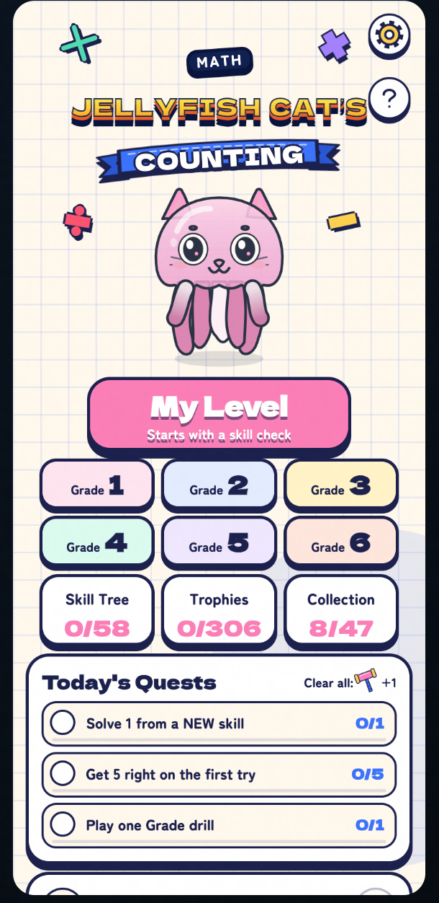
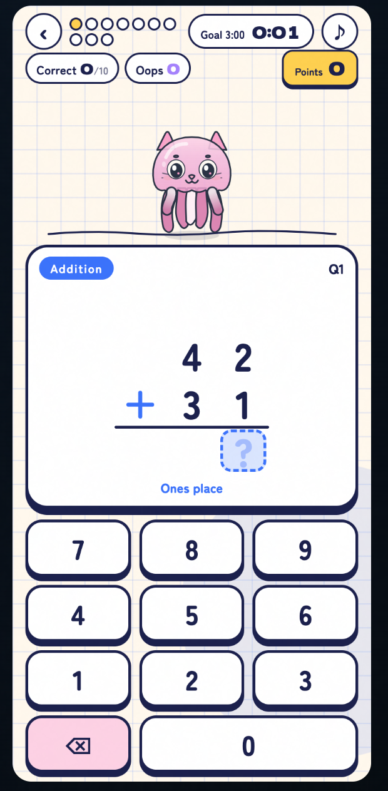
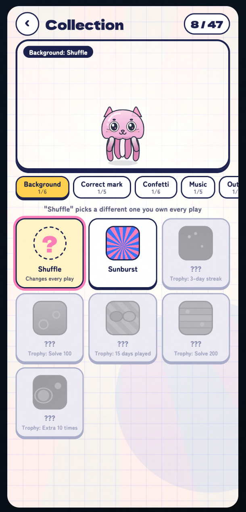
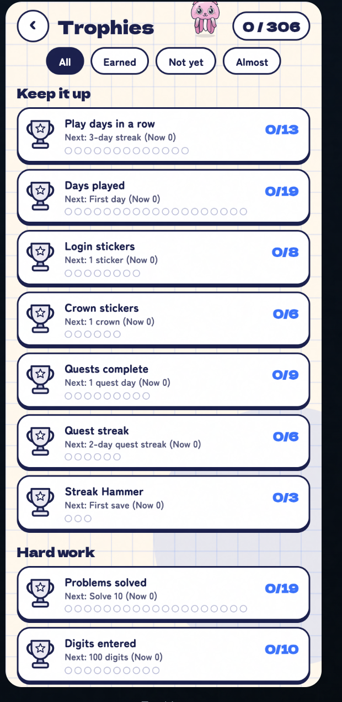
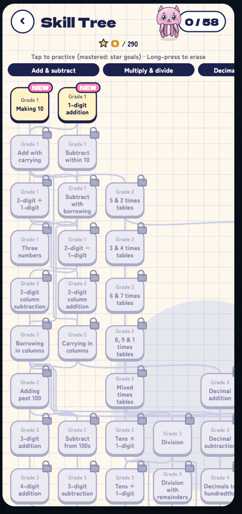

# Jellyfish Cat Math

A free math trainer game for kids, built for Android.

**Google Play:** https://play.google.com/store/apps/details?id=ru.vibecaptain.jellyfishcatmath

## Screenshots

## About

- Free, no ads
- Collects no data
- Suitable for kids of all ages
- Easy to translate into any language

## Tech

- Kotlin Multiplatform
- Jetpack Compose
- Published to Google Play by me (closed testing, production access, review and release)

## Status

Live on Google Play. This repository is a showcase: description, links and project notes. The source code is private.

## Author

Slava Grishanin, Android engineer.

- Portfolio: https://slavagrishanin.github.io/projects
- LinkedIn: https://www.linkedin.com/in/slava-grishanin/
